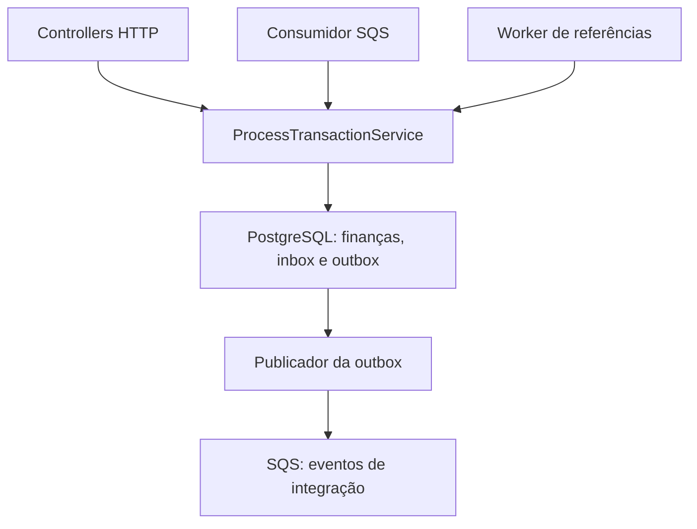

# Mapa do Sistema — das decisões ao código

Atualizado em 23/10/2026.

Este documento relaciona os tópicos do [ARCHITECTURE.md](ARCHITECTURE.md) aos
arquivos que os implementam. O [README.md](README.md) apresenta o projeto e os
comandos de execução; o ARCHITECTURE explica as escolhas; este mapa mostra onde
elas aparecem no código e como as partes trabalham juntas.

## Visão do processamento

HTTP e SQS reutilizam o mesmo serviço financeiro. A inbox participa somente
quando a entrada é uma mensagem. O worker de referências retoma uma transação
existente. O publicador consulta a outbox após o commit financeiro; a aplicação
não mantém um consumidor de negócio da fila de eventos.

## 1. ORM e separação do domínio

Decisão: [ARCHITECTURE, seção 1](ARCHITECTURE.md#1-orm-e-separação-do-domínio).

| Arquivo | Papel na implementação |
| --- | --- |
| [database.module.ts](src/database/database.module.ts) e [mikro-orm.config.ts](src/database/mikro-orm.config.ts) | Inicializam a integração Nest/MikroORM e definem conexão, entidades e migrations. |
| [financial-records.mapper.ts](src/database/mappers/financial-records.mapper.ts) | Converte objetos de domínio em registros e usa rehydrate para reconstruir o estado persistido. |
| [wallet.ts](src/wallets/domain/wallet.ts) e [wager-transaction.ts](src/wagering/domain/wager-transaction.ts) | Encapsulam regras e transições sem depender de decorators do Nest ou tipos monetários do ORM. |
| [app.module.ts](src/app.module.ts) e [main.ts](src/main.ts) | Reúnem os módulos, iniciam a API e habilitam hooks de desligamento. |

Os serviços de aplicação utilizam o ORM diretamente, com um fork do EntityManager
por execução. A separação atual é entre domínio e persistência; não há uma camada
adicional de interfaces de repositório financeiro.

## 2. Money e precisão monetária

Decisão: [ARCHITECTURE, seção 2](ARCHITECTURE.md#2-money-e-precisão-monetária).

| Arquivo | Papel na implementação |
| --- | --- |
| [money.ts](src/shared/domain/money.ts) | Valida formato, moeda e limite; calcula com decimal.js e devolve novas instâncias e strings de duas casas. |
| [wallet.record.ts](src/database/entities/wallet.record.ts), [wager-transaction.record.ts](src/database/entities/wager-transaction.record.ts) e [wallet-ledger.record.ts](src/database/entities/wallet-ledger.record.ts) | Mapeiam valores exatos para NUMERIC(20,2), com representação textual no ORM. |
| [money.spec.ts](src/shared/domain/money.spec.ts) | Verifica centavos, entradas inválidas, limites, operações e conflitos entre moedas. |

O mapper conecta as duas representações: strings nas colunas e Money no domínio.
Saldo e valores financeiros não passam por number; contagens, versões e tempos podem usá-lo.

## 3. Abertura, processamento e unidade transacional

Decisão: [ARCHITECTURE, seção 3](ARCHITECTURE.md#3-abertura-processamento-e-unidade-transacional).

| Arquivo | Papel na implementação |
| --- | --- |
| [prepare-wallet-opening.ts](src/wallets/application/prepare-wallet-opening.ts) | Prepara carteira com versão 1; saldo positivo gera OPENING e crédito inicial sem chamar credit(). |
| [open-wallet.service.ts](src/wallets/application/open-wallet.service.ts) | Grava abertura e eventos em uma transação SQL e devolve sucesso após o commit. |
| [process-transaction.service.ts](src/wagering/application/process-transaction.service.ts) | Bloqueia a carteira com PESSIMISTIC_WRITE, verifica identidade, aplica a operação e confirma finanças, inbox quando presente e outbox juntas. |
| [wallet.ts](src/wallets/domain/wallet.ts) | Valida a movimentação e o ledger antes de alterar saldo, versão e data em memória. |

O bloqueio é da linha da carteira no PostgreSQL. Não é um mutex compartilhado por
todas as carteiras. Os flushes enviam gravações dentro da transação; somente o
commit confirma o conjunto. O método privado apply é reutilizado pelo processamento
inicial e pela retomada de referências.

## 4. Garantias no PostgreSQL e imutabilidade do ledger

Decisão: [ARCHITECTURE, seção 4](ARCHITECTURE.md#4-garantias-no-postgresql-e-imutabilidade-do-ledger).

| Arquivo | Papel na implementação |
| --- | --- |
| [wallet-ledger-entry.ts](src/wallets/domain/wallet-ledger-entry.ts) | Cria lançamentos imutáveis, verifica a equação financeira e protege datas por cópias. |
| [Migration20261021232002.ts](src/database/migrations/Migration20261021232002.ts) | Cria a estrutura inicial de carteiras, preservada no histórico de migrations. |
| [Migration20261022142442.ts](src/database/migrations/Migration20261022142442.ts) | Acrescenta transações, ledger e outbox, unicidade, checks, vínculos e triggers de integridade e imutabilidade. |
| [Migration20261022203000.ts](src/database/migrations/Migration20261022203000.ts) | Acrescenta agendamentos, unicidade de reversões processadas e validação SQL das referências. |
| [Migration20261022220000.ts](src/database/migrations/Migration20261022220000.ts) | Cria inbox e impede alterar ou excluir confirmações já processadas. |

Os arquivos Record descrevem o mapeamento; as migrations versionadas aplicam as
proteções ao banco. Assim, elas também alcançam gravações feitas fora do ORM.
Cada migration possui up e down; o schema não é sincronizado automaticamente ao iniciar.

## 5. Estados, referências e códigos de falha

Decisão: [ARCHITECTURE, seção 5](ARCHITECTURE.md#5-estados-referências-e-códigos-de-falha).

| Arquivo | Papel na implementação |
| --- | --- |
| [wager-transaction.ts](src/wagering/domain/wager-transaction.ts) | Define tipos, estados, códigos de falha e métodos de transição; bloqueia mudanças após um estado terminal. |
| [transaction-reference.ts](src/wagering/domain/transaction-reference.ts) | Verifica compatibilidade da referência e determina a direção da movimentação, incluindo reversões. |
| [process-transaction.service.ts](src/wagering/application/process-transaction.service.ts) | Resolve o ID externo no banco, aplica rejeições ou espera e mantém o mesmo ID interno na retomada. |
| [reference-retry-policy.ts](src/wagering/application/reference-retry-policy.ts) | Define TTL de 15 minutos e backoff de 5 segundos até o teto de 300 segundos. |
| [reference-schedule.record.ts](src/database/entities/reference-schedule.record.ts) e [reference-retry.worker.ts](src/wagering/application/reference-retry.worker.ts) | Persistem tentativas e horários; o worker encontra itens devidos, e o serviço revalida estado e prazo sob locks. |

referenceExternalTransactionId é recebido do provedor; referenceTransactionId é o
ID interno resolvido. O agendamento no banco permite retomar a espera em outra
instância, sem depender da memória da API que recebeu o pedido.

## 6. Resultado histórico e identidade da operação

Decisão: [ARCHITECTURE, seção 6](ARCHITECTURE.md#6-resultado-histórico-e-identidade-da-operação).

| Arquivo | Papel na implementação |
| --- | --- |
| [transaction-payload.ts](src/wagering/application/transaction-payload.ts) | Calcula SHA-256 sobre campos explícitos de negócio em JSON ordenado, sem chave de idempotência ou metadados de transporte. |
| [process-transaction.service.ts](src/wagering/application/process-transaction.service.ts) | Procura chave e identidade externa, compara hash e devolve replay ou conflito sem reaplicar a movimentação. |
| [wager-transaction.ts](src/wagering/domain/wager-transaction.ts) e [wager-transaction.record.ts](src/database/entities/wager-transaction.record.ts) | Preservam o saldo observado no processamento em resultBalance/result_balance. |
| [transaction-result.spec.ts](src/wagering/domain/transaction-result.spec.ts) e [transaction-payload.spec.ts](src/wagering/application/transaction-payload.spec.ts) | Verificam resultado histórico e identidade do conteúdo. |

Se uma aposta deixou 75.00 e um prêmio posterior levou a carteira a 115.00, o
replay da aposta devolve seu resultado de 75.00. A carteira continua com 115.00.

## 7. Mensageria, inbox e publicação da outbox

Decisão: [ARCHITECTURE, seção 7](ARCHITECTURE.md#7-mensageria-inbox-e-publicação-da-outbox).

| Arquivo | Papel na implementação |
| --- | --- |
| [queue.port.ts](src/messaging/application/queue.port.ts) e [sqs.transport.ts](src/messaging/infrastructure/sqs.transport.ts) | Definem operações da fila e as adaptam ao AWS SDK, incluindo envio, recebimento, ack, visibilidade e readiness. |
| [setup-queues.ts](scripts/setup-queues.ts) e [compose.yaml](compose.yaml) | Preparam filas FIFO/redrive e a infraestrutura local de PostgreSQL e LocalStack. |
| [parse-wager-message.ts](src/messaging/application/parse-wager-message.ts) | Valida o envelope e reutiliza o DTO da operação antes de chamar o serviço financeiro. |
| [wager-consumer.worker.ts](src/messaging/application/wager-consumer.worker.ts) | Consome, renova visibilidade, chama o serviço com contexto de inbox e decide ack, retry ou DLQ. |
| [inbox-message.ts](src/messaging/domain/inbox-message.ts) e [inbox.record.ts](src/database/entities/inbox.record.ts) | Representam e persistem confirmação, hash e resultado por consumerName/messageId. |
| [outbox-message.ts](src/messaging/domain/outbox-message.ts) e [outbox.record.ts](src/database/entities/outbox.record.ts) | Representam e persistem evento, tentativas, próxima execução e publicação. |
| [outbox-publisher.worker.ts](src/messaging/application/outbox-publisher.worker.ts) | Seleciona eventos confirmados com FOR UPDATE SKIP LOCKED, publica e marca resultado ou próxima tentativa. |
| [integration-event.ts](src/shared/domain/integration-event.ts) | Define envelope e serialização comuns aos eventos concretos de transação e saldo. |
| [messaging.module.ts](src/messaging/messaging.module.ts) | Conecta QueuePort ao SqsTransport e registra consumidor e publicador no Nest. |

O consumidor confirma somente após o commit financeiro. O publicador trabalha em
uma transação separada, sem manter o lock da carteira durante a chamada ao SQS.
Se o envio for aceito e a marcação falhar, o evento pode se repetir com o mesmo eventId.

## 8. Contratos HTTP e classificação dos resultados

Decisão: [ARCHITECTURE, seção 8](ARCHITECTURE.md#8-contratos-http-e-classificação-dos-resultados).

| Arquivo | Papel na implementação |
| --- | --- |
| [wallets.controller.ts](src/wallets/http/wallets.controller.ts) e [create-wallet.dto.ts](src/wallets/http/create-wallet.dto.ts) | Recebem abertura e consultas da carteira, validando o contrato de entrada. |
| [wagering.controller.ts](src/wagering/http/wagering.controller.ts) e [submit-transaction.dto.ts](src/wagering/http/submit-transaction.dto.ts) | Recebem operações e Idempotency-Key, retornando o status HTTP conforme o resultado. |
| [provider-transactions.controller.ts](src/wagering/http/provider-transactions.controller.ts) | Expõe a busca pelo provedor e seu ID externo. |
| [wallets-errors.filter.ts](src/wallets/http/wallets-errors.filter.ts) e [database-errors.filter.ts](src/operations/http/database-errors.filter.ts) | Traduzem erros conhecidos de carteira/dinheiro e erros SQL sem expor consultas na resposta. |
| [wallets.module.ts](src/wallets/wallets.module.ts) e [wagering.module.ts](src/wagering/wagering.module.ts) | Registram controllers, serviços, guard e validação conforme a configuração de cada módulo. |

DTOs validam o formato; domínio valida regras financeiras; o serviço coordena a
transação. Encontrar um playerId na carteira não autentica quem fez a chamada.

## 9. Consultas, reconciliação e observabilidade

Decisão: [ARCHITECTURE, seção 9](ARCHITECTURE.md#9-consultas-reconciliação-e-observabilidade--23102026).

| Arquivo | Papel na implementação |
| --- | --- |
| [wallet-queries.service.ts](src/wallets/application/wallet-queries.service.ts), [ledger-cursor.ts](src/wallets/application/ledger-cursor.ts) e [ledger-query.dto.ts](src/wallets/http/ledger-query.dto.ts) | Consultam ledger por (created_at,id), validam limite/cursor e comparam saldo e soma do ledger em um único SELECT, sem reparar divergências. |
| [transaction-queries.service.ts](src/wagering/application/transaction-queries.service.ts) | Consulta a transação por identidade interna ou externa e devolve seu saldo histórico. |
| [operations.controller.ts](src/operations/http/operations.controller.ts) | Expõe liveness, readiness de PostgreSQL/SQS e métricas com gauges do banco. |
| [telemetry.ts](src/operations/telemetry.ts) e [http-observability.interceptor.ts](src/operations/http/http-observability.interceptor.ts) | Mantêm contadores/histograma por processo e logs HTTP com correlação e IDs, sem corpo financeiro completo. |
| [operations.module.ts](src/operations/operations.module.ts) | Registra o interceptor e o filtro SQL globais e disponibiliza os endpoints operacionais. |

Métricas locais reiniciam com o processo. Os gauges representam dados compartilhados
no banco; somá-los entre réplicas duplicaria o mesmo estado global.

## 10. Autenticação e recuperação operacional

Decisão: [ARCHITECTURE, seção 10](ARCHITECTURE.md#10-autenticação-e-recuperação-operacional--23102026).

| Arquivo | Papel na implementação |
| --- | --- |
| [provider-auth.guard.ts](src/shared/http/provider-auth.guard.ts) | Expõe um guard no-op para futura integração com IdP externo; hoje permite chamadas e não oferece autenticação. |
| [process-transaction.service.ts](src/wagering/application/process-transaction.service.ts) | recordPermanentFailure recupera resultado confirmado ou registra FAILED, inbox e evento juntos, sem movimentar saldo. |
| [wager-transaction-failed.event.ts](src/wagering/domain/wager-transaction-failed.event.ts) | Define o evento versionado de falha operacional auditada. |
| [wager-consumer.worker.ts](src/messaging/application/wager-consumer.worker.ts) | Coordena auditoria no esgotamento e envio à DLQ; redelivery de FAILED tenta concluir o envio antes do ack. |
| [process.fixture.ts](test-process/process.fixture.ts) | Inicia processos independentes e pausa somente nos testes, após commit/antes de ack ou após envio/antes de marcar outbox. |
| [recovery.integration.spec.ts](test-process/recovery.integration.spec.ts) | Encerra os processos e verifica retomada, não duplicação e reconciliação com PostgreSQL/SQS reais. |

Se o banco impedir também a auditoria, a DLQ preserva a mensagem; não há criação
SQL garantida nem recuperação administrativa automática. A demonstração de
consumidor de eventos fica exclusivamente na suíte, com recibo e efeito atômicos.

## 11. Validação e limites conhecidos

Decisão e resultados: [ARCHITECTURE, seção 11](ARCHITECTURE.md#11-validação-e-limites-conhecidos).

| Arquivo | Evidência ou configuração |
| --- | --- |
| [wallets.integration.spec.ts](test/wallets.integration.spec.ts) e [app.e2e.spec.ts](test/app.e2e.spec.ts) | 66 casos HTTP/SQL no total, incluindo constraints, atomicidade, referências, FAILED, consultas e reconciliação. O transporte controlado provoca falhas de forma determinística. |
| [messaging.integration.spec.ts](test-sqs/messaging.integration.spec.ts) | Sete casos com PostgreSQL e LocalStack: entregas, inbox, ack, retry, DLQ, publishers e readiness. |
| [recovery.integration.spec.ts](test-process/recovery.integration.spec.ts) | Quatro casos com processos independentes, concorrência, interrupções e retomada. |
| [integration-config.ts](test/integration-config.ts) e [prepare-test-database.ts](scripts/prepare-test-database.ts) | Exigem banco separado terminado em _test e preparam o banco exclusivo da validação. |
| [package.json](package.json), [tsconfig.test.json](tsconfig.test.json) e [bunfig.toml](bunfig.toml) | Definem comandos, compilação prévia dos testes e sua execução pelo Bun. |

Os arquivos .spec.ts junto ao código em src somam 117 testes unitários aprovados
localmente. Em 23/10/2026, as suítes de 66, sete e quatro testes passaram no ambiente
Windows do autor, com PostgreSQL 17 e LocalStack em Docker. Esses resultados
comprovam os cenários exercitados; não representam certificação de produção ou
medição de carga. As limitações assumidas estão centralizadas no ARCHITECTURE.
